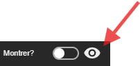

La propriété *Montrer?* permet d'afficher/cacher la modale.²

> 💡 **ASTUCE** 
> Vous pouvez activer cette propriété dans le designer pour apercevoir le contenu de la modale ou pour régler son ancrage. Vous avez également la possibilité d'avoir un apperçu de la modale en cliquant sur le bouton "oeil" juste à coté :
>
> 
