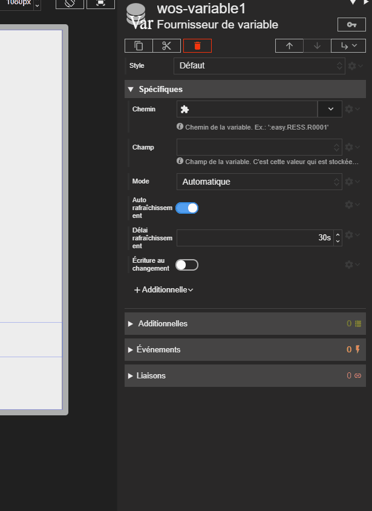

Cette propriété va contenir un *chemin* vers la variable à récupérer. C'est un chemin au sens REDY, par ex : `:easy.RESS.R00001` ou même `:easy.RESS.R00001.Output`.

Un explorateur de paramétrage de REDY aide à saisir le chemin.

