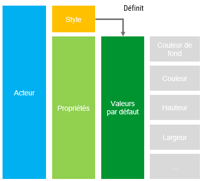
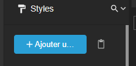
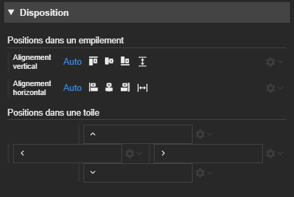
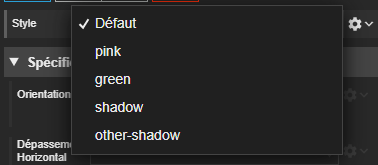
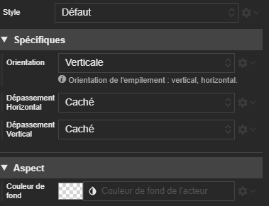
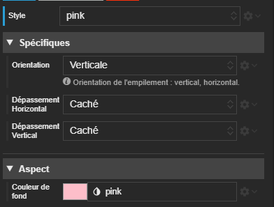
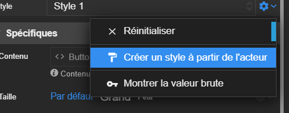



# Style d'un acteur

## Définition

Les propriétés d'un [acteur](./actor/index.md) sont initialisées avec des valeurs par défaut. Ces dernières sont définies dans le style qu'utilise l'acteur.
Au départ, un acteur utilise le style `default` (nommé **Défaut** dans Studio). Mais il est possible d'établir d'autres styles et changer les valeurs par défaut d'un acteur.



Un style est défini pour un type donné.

Un style est toujours défini basé sur un autre (donc au moins celui par défaut!).

### Les styles d'un type d'acteur

Pour un type d'acteur, les styles disponibles sont :

- le style **Défaut** (clé `default`) : il porte les valeurs par défaut du type d'acteur. Il existe toujours et ne se modifie pas ;
- les styles prédéfinis, fournis par certains types d'acteur (voir [Styles prédéfinis](#styles-prédéfinis)) ;
- les styles définis dans le projet avec le [designer de style](#le-designer-de-style).

Un style ne contient que les valeurs qu'il redéfinit. Les autres valeurs proviennent du style sur lequel il est basé, qui lui-même hérite de sa propre base, et ainsi de suite jusqu'au style **Défaut**.

### Styles prédéfinis

Certains types d'acteur fournissent des styles prêts à l'emploi, en plus du style **Défaut** :

- la [Cellule de tableau de données](./actor-types/display/data-table-cell.md) : *Texte*, *Texte en-tête*, *Nombre*, *Booléen*, *Booléen image*, *Date/Heure* et *Personnalisé*. Ils servent au champ **Style de cellule** des colonnes d'un [Tableau de données](./actor-types/display/data-table.md) ;
- le [Bouton de menu](./actor-types/input/menu-button.md) : *Actif défaut*, *Inactif défaut*, *Actif navbar défaut*, *Inactif navbar défaut*. Ils servent aux champs **Style du bouton actif** et **Style du bouton inactif** du [Menu de navigation](./actor-types/input/nav-menu.md) et de la [Barre de navigation](./actor-types/input/navbar.md).

Comme le style **Défaut**, les styles prédéfinis n'apparaissent pas dans l'arborescence des styles et ne se modifient pas. En revanche, ils sont proposés partout où l'on choisit un style de ce type : vous pouvez donc créer un style **basé sur** un style prédéfini.

## Dans Studio

### Gestion des Styles

La définition des styles d'acteur est une section à part entière dans Studio. Un designer dédié permet de les créer et les modifier.


#### Accéder aux styles

Dans la barre latérale de Studio, le bouton **Styles** (icône de pinceau ci-dessus) ouvre le panneau des styles du projet. Il n'est disponible que lorsqu'un projet est ouvert.

Un clic sur un style l'ouvre dans un onglet du [designer de style](#le-designer-de-style).

#### L'arborescence des styles

Le panneau présente les styles du projet regroupés par type d'acteur :

- chaque groupe est titré par le nom du type d'acteur ;
- sous ce titre, chaque style est affiché par son nom, précédé de l'icône du type. Au survol, une infobulle indique son nom et sa clé ;
- une flèche bleue suit le nom d'un style basé sur un autre style du projet. Son infobulle indique ce style : *Basé sur : …* ;
- un point orange (*Modification*) signale un style ouvert dont les modifications ne sont pas encore sauvées.

Seuls les types d'acteur qui possèdent au moins un style dans le projet apparaissent dans l'arborescence.

{: .info }
> Les styles **Défaut** et les [styles prédéfinis](#styles-prédéfinis) ne figurent pas dans l'arborescence.

#### Créer un style

En haut du panneau, le bouton **Ajouter un style** ouvre la liste des types d'acteur. Choisissez un type : un nouveau style est créé pour ce type et s'ouvre dans le designer.



Pour un type déjà présent dans l'arborescence, vous pouvez aussi :

- cliquer sur le bouton **+** à droite du titre du type ;
- ou faire un clic droit sur le titre du type et choisir **Ajouter**.

Le nouveau style est nommé *Style* suivi d'un numéro (par exemple *Style 3*) et sa clé est `style` suivie du même numéro (par exemple `style3`). Il est basé sur le style **Défaut** et ne redéfinit encore aucune valeur. Renommez-le et modifiez ses valeurs dans le [designer](#le-designer-de-style).

Vous pouvez créer des styles pour tous les types d'acteur, y compris les fournisseurs de données et les composites.

Vous pouvez aussi [créer un style à partir d'un acteur](#créer-un-style-à-partir-dun-acteur) d'une scène ou d'un composite.

#### Copier, coller et dupliquer un style

Un clic droit sur un style de l'arborescence ouvre son menu :

- **Copier** : copie le style dans le presse-papier ;
- **Dupliquer** : crée une copie du style, du même type ;
- **Supprimer** : voir [Supprimer un style](#supprimer-un-style).

Le bouton **Coller** (icône de presse-papier) est présent en haut du panneau, à droite du titre de chaque type, dans le menu du clic droit sur un titre de type et dans l'inspecteur du designer. Il crée un nouveau style à partir du style copié. Celui d'en haut du panneau permet de coller un style pour un type d'acteur qui n'a encore aucun style dans le projet.

Le style dupliqué ou collé reprend le type, la base et les valeurs du style d'origine. Il est nommé *Copie de* suivi du nom d'origine, reçoit une nouvelle clé (`style` suivie d'un numéro) et s'ouvre dans le designer.

{: .info }
> Le style collé est toujours ajouté au type d'acteur du style copié, quel que soit le bouton **Coller** utilisé.

#### Supprimer un style

Choisissez **Supprimer** dans le menu du clic droit sur le style, ou cliquez sur le bouton de suppression (icône de corbeille) dans l'inspecteur du designer. Après confirmation, le style est supprimé et son onglet est fermé.

{: .warning }
> La suppression ne modifie ni les acteurs qui utilisent ce style, ni les styles basés sur lui. Un acteur qui fait référence à un style qui n'existe plus utilise le style **Défaut**. De même, un style basé sur un style qui n'existe plus est basé sur le style **Défaut**.

#### Réorganiser les styles

Les styles se réordonnent par glisser-déposer :

- un style, en le saisissant par son icône, au sein de son type ;
- un type entier, en le saisissant par son titre.

Cet ordre n'est que celui de l'arborescence.

#### Rechercher un style

Le bouton loupe, dans l'en-tête du panneau, ouvre un champ *Rechercher un style...*. La liste des styles se filtre sur leur nom au fur et à mesure de la saisie, sans tenir compte des majuscules ni des accents. *Aucun style trouvé* s'affiche si aucun nom ne correspond.

Un clic sur un résultat ouvre le style dans le designer.

### Le designer de style

Le designer de style s'ouvre dans un onglet, comme une scène ou un composite. Il présente un aperçu à gauche et l'inspecteur du style à droite.

#### Barre d'actions

Au-dessus de l'aperçu, quatre boutons :

- **Sauver** (`Ctrl+S`) : enregistre le style. Les scènes et composites ouverts sont mis à jour : leurs acteurs de ce type tiennent compte des nouvelles valeurs ;
- **Annuler** : abandonne toutes les modifications non sauvées, après confirmation ;
- **Annuler la modification** et **Appliquer la modification** : annulent et rétablissent les modifications une à une (voir les [raccourcis clavier](./keyboard-shortcuts.md)).

#### Aperçu

L'aperçu affiche un acteur du type du style, rendu avec les valeurs du style, au centre d'un cadre en pointillés de 600 × 600 px. Il se met à jour à chaque modification.

À droite de la barre d'actions, les outils d'aperçu permettent d'ajuster le zoom (en `%`), de choisir une taille d'écran prédéfinie (*Standard mobile*, *iPhone SE*, *iPad Air*, *Full HD*…) ou *Personnalisée*, d'en saisir la largeur et la hauteur (en `px`), de faire pivoter l'écran et d'ajuster le zoom pour que l'écran tienne dans l'aperçu.

Comme dans les designers de scène et de composite, les [indicateurs d'utilisation des acteurs](./hints.md#surveiller-les-indicateurs-dutilisation-des-acteurs) sont affichés en bas à gauche de Studio.

#### Inspecteur du style

L'inspecteur du designer de style reprend celui d'un acteur, avec les particularités suivantes.

En tête de l'inspecteur :

- les boutons **Copier**, **Coller** et **Supprimer** s'appliquent au style ;
- le bouton de **Changement de clé** (icône de clé) permet de modifier la clé du style. La clé `default` est réservée au style **Défaut** et une clé ne peut être utilisée que par un seul style d'un même type d'acteur.

Puis viennent :

- le champ **Nom** : le nom du style, affiché dans l'arborescence et dans les listes de choix de style ;
- le champ **Basé sur** : le style dont celui-ci hérite les valeurs. Il propose le style **Défaut**, les [styles prédéfinis](#styles-prédéfinis) et les autres styles du même type. Le style lui-même et les styles qui sont basés sur lui ne sont pas proposés, pour éviter un héritage circulaire. Changer de base ne modifie pas les valeurs que le style redéfinit : seules les valeurs héritées changent ;
- les sections de propriétés de l'acteur (*Spécifiques*, *Aspect*, *Texte*, *Disposition*…), comme dans l'inspecteur d'un acteur. Une valeur saisie ici devient la valeur par défaut des acteurs qui utilisent le style.

Le champ *Filtrer...* et les boutons pour déplier ou replier toutes les sections fonctionnent comme dans l'inspecteur d'un acteur.

Dans la section *Disposition*, le style peut aussi définir le positionnement par défaut de l'acteur lorsqu'il est placé dans un acteur *Toile* (*Positions dans une toile*).



##### Valeurs issues des librairies

La valeur d'une propriété d'un style peut provenir d'une [librairie](./libraries/index.md). Dans le menu d'options de la propriété, *Lier à...* ouvre la fenêtre de [liaison](./binding.md), qui ne propose ici que les sources de type *Librairies* : *Couleur*, *Image*, *Constante* et *Texte*. *Copier la liaison*, *Coller la liaison* et *Supprimer la liaison* sont aussi disponibles.

##### Ce que l'inspecteur du style ne propose pas

Un style ne porte que des valeurs de propriétés. Par rapport à l'inspecteur d'un acteur dans une scène, l'inspecteur du style ne propose pas :

- les évènements et les scripts ;
- les liaisons vers d'autres sources que les librairies ;
- les additionnelles ;
- les relations ;
- le champ **Style** (remplacé par **Basé sur**) ;
- les actions propres aux acteurs d'une scène (ajout d'enfant, couper, déplacement…) ;
- les paramètres de scène d'un acteur *Écran*.

#### Limites

- Les presets d'un type d'acteur ne sont pas proposés dans la liste des types du designer de style. Un acteur créé à partir d'un preset est un acteur du type d'origine : il utilise les styles de ce type (voir [Presets](./actor/index.md#presets)).
- La [sélection contextuelle](./context-selection.md) n'est pas disponible dans le designer de style.
- Le changement de clé d'un style ne met pas à jour les acteurs qui l'utilisent : ils font toujours référence à l'ancienne clé et utilisent donc le style **Défaut**. Pensez à leur réattribuer le style.

### Utilisation dans le designer

Dans chaque acteur, le champ **Style** permet de le changer pour un autre correspondant à son type.



Regardez la couleur de fond :



Elle est définie à sa valeur par défaut : aucune.

Après avoir changé de style pour `pink`, la valeur affichée du champ est passée à `pink`. Mais, ne vous y trompez pas : c'est sa valeur par défaut qui a changé. Si une couleur autre que celle par défaut avait été définie, elle aurait été conservée.



{: .info }
> Le champ **Style** n'est pas proposé pour un *Bouton de menu* : son style est choisi par le menu qui le contient (**Style du bouton actif** / **Style du bouton inactif**).

#### Créer un style à partir d'un acteur

Dans le menu d'options du champ **Style** d'un acteur, choisissez **Créer un style à partir de l'acteur**.



Un nouveau style est créé pour le type de l'acteur et s'ouvre dans le designer de style :

- il est nommé d'après la clé de l'acteur, suivie d'un numéro ;
- il est basé sur le style qu'utilise l'acteur ;
- il reprend les valeurs de propriétés définies sur l'acteur.

{: .info }
> L'acteur, lui, conserve son style : choisissez le nouveau style dans son champ **Style** pour le lui appliquer.

### Structure JSON d'un style

Chaque style est enregistré dans le projet sous la forme d'un objet JSON : sa clé (`key`), son nom (`name`), le type d'acteur (`type`), le style sur lequel il est basé (`basedOn`, absent s'il est basé sur **Défaut**) et ses valeurs propres (`properties`).

Voici un exemple de deux styles pour les empilements :
```json
{
  "key": "shadow",
  "name": "Ombre",
  "type": "layout/stack",
  "properties": {
    "borderRadius": "5px",
    "paddingTop": "1em",
    "paddingBottom": "1em",
    "paddingRight": "1em",
    "paddingLeft": "1em",
    "marginTop": "1em",
    "marginBottom": "1em",
    "marginRight": "1em",
    "marginLeft": "1em",
    "boxShadow": "0 0 5px 3px #888"
  }
}
```

```json
{
  "key": "other-shadow",
  "name": "Autre ombre",
  "type": "layout/stack",
  "basedOn": "shadow",
  "properties": {
    "borderRadius": "15px",
    "boxShadow": "0 0 15px 7px #888"
  }
}
```

Vous remarquerez la définition de `other-shadow` basé sur `shadow` qui hérite des définitions du second tout en redéfinissant `borderRadius` et `boxShadow`.

## Par script

La méthode [`changeStyleName(styleName)`](./scripts/reference/actor.md#changestylenamestylename) d'un acteur lui applique le style de clé `styleName`, et l'information [`styleName`](./scripts/reference/actor.md#stylename) donne la clé du style qu'il utilise. Si la clé ne correspond à aucun style du type de l'acteur, ses propriétés reprennent les valeurs du style **Défaut**.
