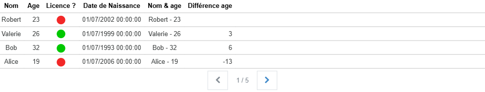

# Tableau de données

Un acteur qui permet de créer des tableaux de données dynamiques.



{: .important-title }

> 💎 Acteur Avancé
>
> Le tableau de données est un acteur qui nécessite une bonne compréhension de son fonctionnement et de ses propriétés ainsi que des notions de JSON et parfois du JavaScript.

L'entrée des données se fait sous la forme de tableau d'objets `JSON`. Il est possible de définir des colonnes typées et personnalisées.
De nombreux évènements sont disponibles pour interagir avec le tableau ou chaque cellule et avec des boutons de pagination.

Les types de colonnes disponibles sont :

- texte : pour afficher simplement la donnée d'une cellule,
- nombre : pour afficher directement un nombre,
- booléen : pour afficher une valeur vraie ou fausse et définir les textes associés,
- booléen images : pour afficher une image en fonction de la valeur booléenne et définir les textes associés,
- date/heure : pour afficher une date ou une heure avec un format personnalisable,
- personnalisé : pour utiliser un composite comme contenu de la cellule.





# Propriétés
{: #proprietes }



# Informations
{: #informations }

Accessibles par script, via `this` dans un script de l'acteur ou `context.getActor('clé')` depuis un autre acteur.



# Méthodes
{: #methodes }



# Événements
{: #evenements }

Les évènements communs à tous les acteurs sont décrits avec l'[acteur de base]({{ site.baseurl }}/concepts/scripts/reference/actor.html).



## ⚡Evènements souris et tactile

Dans les éèvènements souris et tactile de l'acteur tableau de données, le context contient des informations supplémentaires sur la cellule ou la ligne de données concernée par l'évènement.
C'est donc un bon moyen pour interagir avec les cellules du tableau.

## Contexte des évènements

Le contexte des évènements contient les informations suivantes :

| Champ              | Type    | Description                         |
| ------------------ | ------- | ----------------------------------- |
| `isHeader`         | Boolean | Vrai si c'est une cellule d'en-tête |
| `isCell`           | Boolean | Vrai si c'est une cellule           |
| `column`           | Object  | La définition de la colonne         |
| `rowKey`           | String  | La clé de la ligne                  |
| `columnKey`        | String  | La clé de la colonne                |
| `dataRow`          | Object  | La ligne de données complète        |
| `dataRows`         | Array   | Toutes les lignes de données        |
| `value`            | Any     | La valeur brute de la cellule       |
| `cell`             | Object  | La cellule en cours de rendu        |
| `transformedValue` | Any     | La valeur transformée de la cellule |
| `text`             | String  | Le texte affiché dans la cellule    |
| `content`          | Any     | Le contenu affiché dans la cellule  |
| `row`              | Object  | La ligne en cours de rendu          |
| `rows`             | Array   | Toutes les lignes en cours de rendu |

## Disponibilité des champs dans les évènements

| Champ              | onWillCellRender | onCellContentTransform | onDidCellRender | onDidTableRender | Evènements souris |
| ------------------ | ---------------- | ---------------------- | --------------- | ---------------- | ----------------- |
| `isHeader` | ✔️ | ✔️ | ✔️ | ❌ | ✔️ |
| `isCell` | ✔️ | ✔️ | ✔️ | ❌ | ✔️ |
| `column` | ✔️ | ✔️ | ✔️ | ❌ | ✔️ |
| `rowKey` | ✔️ | ✔️ | ✔️ | ❌ | ✔️ |
| `columnKey` | ✔️ | ✔️ | ✔️ | ❌ | ✔️ |
| `dataRow` | ✔️ | ✔️ | ✔️ | ❌ | ✔️ |
| `dataRows` | ✔️ | ✔️ | ✔️ | ❌ | ✔️ |
| `value` | ✔️ | ✔️ | ✔️ | ❌ | ✔️ |
| `cell` | ✔️ | ✔️ | ✔️ | ❌ | ✔️ |
| `transformedValue` | ❌ | ❌ | ✔️ | ❌ | ✔️ |
| `text` | ❌ | ❌ | ✔️ | ❌ | ✔️ |
| `content` | ❌ | ❌ | ✔️ | ❌ | ✔️ |
| `row` | Partiellement | Partiellement | Partiellement | ❌ | ✔️ |
| `rows` | Partiellement | Partiellement | Partiellement | ✔️ | ✔️ |
| `headerRow` | ❌ | ❌ | ❌ | ✔️ | ❌ |

# Hérite de
{: #herite-de }



# La pagination

Le tableau accèpte la pagination mais doit être implémentée avec l'évènement de changement de page `onChangeDataPage`.

Pour faire apparaitre les boutons de pagination, il faut activer l'option `displayPaging` et augmenter le nombre de page avec le champ `pageMax` dans les propriétés de l'acteur.

En suite, il faut gérer l'évènement `onChangeDataPage` pour modifier les données affichées en fonction de la page demandée.

L'évènement fournit le numéro de la page demandée dans le champ `context.page` de l'objet évènement.

exemple d'implémentation de la pagination :



```javascript
// onChangeDataPage

// taille de chaque page
const pageSize = 10;

const data = [
  /* ... tableau complet des données ... */
];

// Extraction des lignes de données pour la page demandée
const dataPage = data.slice((context.page - 1) * pageSize, context.page * pageSize);

// Mise à jour des lignes de données en fonction de la page demandée. Le format est du JSON texte.
this.properties.dataRows = JSON.stringify(dataPage);
```



Un exemple d'acteur au complet avec la gestion de la pagination :


