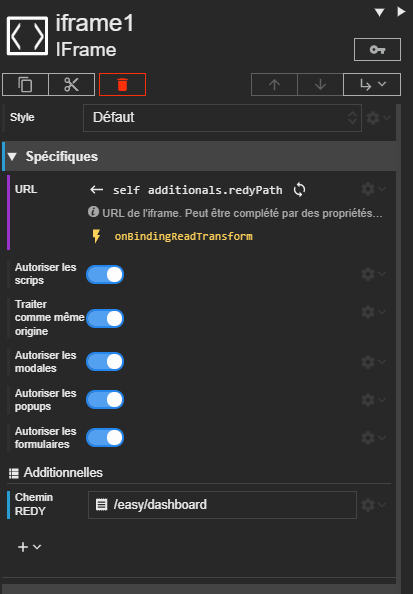



# IFrame

L'acteur Iframe permet d'intégrer une page web dans votre scène.





# Propriétés
{: #proprietes }



# Informations
{: #informations }

Accessibles par script, via `this` dans un script de l'acteur ou `context.getActor('clé')` depuis un autre acteur.



# Hérite de
{: #herite-de }



# Quelques exemples

## iframe vers REDY

<div class="code-example" markdown="1">

Voici un exemple d'iFrame qui montre une page du REDY.



L'additionnelle *Chemin REDY* permet de définir le chemin vers la page, depuis la racine du REDY (ici, on affiche le tableau de bord).

</div>

```text
SYNAPPS-STUDIO-ACTOR|{"type":"display/iframe","key":"iframe1","properties":{"verticalAlignment":"expand"},"additionalDefs":{"redyPath":{"type":"text","label":"Chemin REDY"}},"additionals":{"redyPath":"/easy/dashboard"},"bindings":{"properties.url":{"sourceType":"relative","sourcePath":"self","path":"additionals.redyPath"}},"events":{"properties/url/binding/onReadTransform":["return  `${this.dataStores.redy.host.domain}/WSID${this.dataStores.redy.host.session.sid}${context.value}`;"]}}
```
