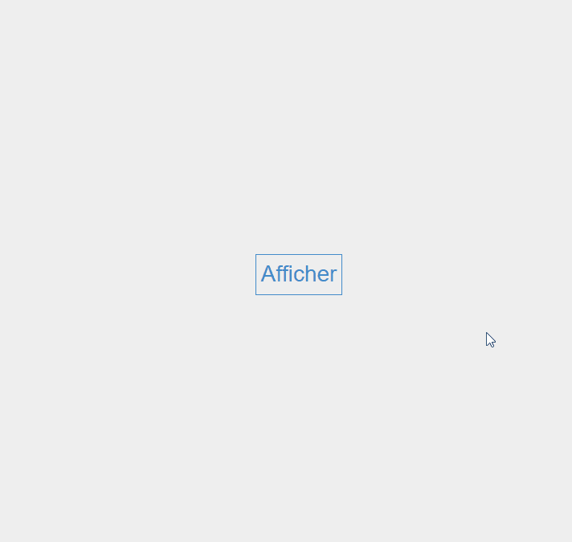
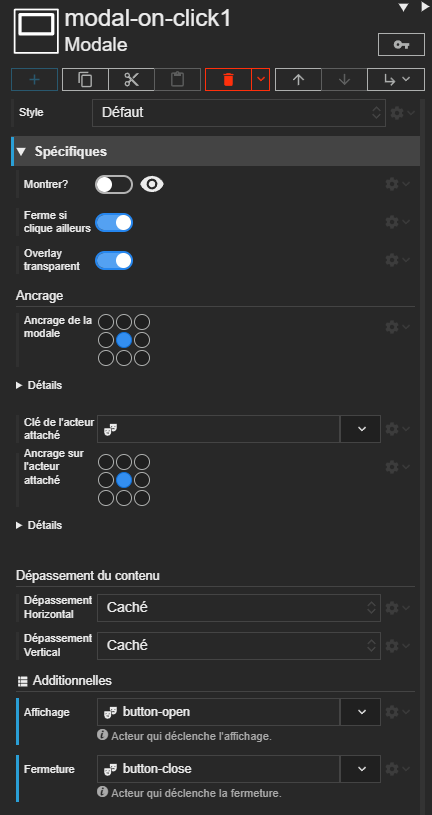

# Modale

Acteur qui permet d'afficher une boite de dialogue ou un menu.







# Propriétés
{: #proprietes }



# Informations
{: #informations }

Accessibles par script, via `this` dans un script de l'acteur ou `context.getActor('clé')` depuis un autre acteur.



# Méthodes
{: #methodes }



# Événements
{: #evenements }

Les évènements communs à tous les acteurs sont décrits avec l'[acteur de base]({{ site.baseurl }}/concepts/scripts/reference/actor.html).



# Hérite de
{: #herite-de }



# Ancrage de la modale

Par défaut, la modale va s'afficher au centre de l'écran. Vous pouvez définir un ancrage complètement différent.

Pour ancrer la modale, il y à trois points à observer :
- *L'acteur attaché :* par défaut, aucun acteur n'est attaché à la modale. Mais si vous en définissez un, la modale se positionnera par rapport à lui.
- *L'ancrage Horizontal/Vertical de la modale :* ces deux propriétés définissent un point sur la modale qui sera son ancre. C'est ce point qui sera ancré à celui de l'acteur attaché.
- *L'ancrage Horizontal/Vertical de l'acteur attaché :* ces deux propriétés définissent un point sur l'acteur attaché qui sera son ancre. C'est ce point qui sera ancré à celui de la modale.

Dans l'exemple ci dessous, la <span style="color: red;">**modale**</span> est attachée à un <span style="color: green;">**acteur bouton**</span> et son ancre est matérialisé par un cercle rouge, l'ancrage sur le bouton est vert :


# Usage

La modale est un acteur de disposition qui n'accepte qu'**un seul enfant**. En général, vous y placerez un empilement qui contiendra l'interface de dialogue.

{: .tip }
> Placez le plus souvent possible vos modales tout en bas de vos arborescence d'acteurs. Cela évitera que leur contenu gène l'affichage des autres acteurs dans le designer.

{: .warning }
> N'oubliez pas de définir une taille pour votre modale. Sinon, elle ne s'affichera pas correctement.

## Montrer/Cacher la modale

C'est la propriété *Montrer ?* qui permet d'afficher ou de cacher la modale. Vous pouvez modifier cette propriété par liaison.

Vous pouvez également utiliser un script dans un évènement. Par exemple, dans un acteur bouton, dans l'évènement `onClick`, vous pouvez écrire le script suivant pour afficher une modale nommée `myModal` :

```javascript
context.getActor('myModal').properties.isShown = true;
```

Si vous n'êtes pas à l'aise avec les scripts, vous pouvez utiliser le preset **Modale au clic** qui est préconfiguré pour afficher/cacher la modale au clic sur un autre acteur.

# Réinitialisation des héritages de propriété

L'héritage des propriétés est brisé dans une modale. Il faudra redéfinir ces propriétés à l'intérieure.

Par exemple, si vous définissez une taille de texte de 10px sur l'acteur principal d'une scène, cela ne sera pas appliqué à la modale.


# Presets

## Modale au clic

Ce preset de modale est préconfiguré pour indiquer l'acteur qui lorsqu'on cliquera dessus déclenchera son affichage et l'acteur qui déclenchera sa fermeture.

Voici un exemple de scène qui emploie ce preset :


```
SYNAPPS-STUDIO-SCENE|{"config":{"key":"scene145","name":"Exemple de modale au clic"},"leadActor":{"type":"layout/stack","key":"stack1","children":[{"type":"input/button","key":"button-open","properties":{"content":"Montrer","horizontalAlignment":"middle","verticalAlignment":"middle"}},{"type":"layout/modal","key":"modal-on-click1","properties":{"height":"200px","width":"200px","borderColor":"rgba(46, 193, 38, 1)","borderWidth":"8px","borderStyle":"solid"},"additionalDefs":{"showTrigger":{"type":"actor","label":"Affichage","helperTxt":"Acteur qui déclenche l'affichage."},"hideTrigger":{"type":"actor","label":"Fermeture","helperTxt":"Acteur qui déclenche la fermeture."}},"additionals":{"showTrigger":"button-open","hideTrigger":"button-close"},"children":[{"type":"layout/stack","key":"stack2","properties":{"verticalAlignment":"expand","paddingTop":"2px","paddingBottom":"2px","paddingRight":"2px","paddingLeft":"2px"},"children":[{"type":"display/text","key":"text1","properties":{"content":"la modale","horizontalAlignment":"middle","verticalAlignment":"middle"}},{"type":"input/button","key":"button-close","properties":{"content":"Fermer","mode":"danger","outline":true,"textAlign":"center"}}]}],"events":{"onPostInit":["const showTrigger = context.getActor(this.additionals.showTrigger);","","if (showTrigger) {","  const originalOnClickFx = showTrigger.events.onClick ? showTrigger.events.onClick.fx.bind(showTrigger) : null;","  if (originalOnClickFx) {","    showTrigger.removeEvent('onClick');","  }","","  showTrigger.createEvent('onClick', (...args) => {","    this.properties.isShown = true;","    if (originalOnClickFx) {","      originalOnClickFx(...args);","    }","  });","}","","const hideTrigger = context.getActor(this.additionals.hideTrigger);","","if (hideTrigger) {","  const originalOnClickFx = hideTrigger.events.onClick ? hideTrigger.events.onClick.fx.bind(showTrigger) : null;","  if (originalOnClickFx) {","    hideTrigger.removeEvent('onClick');","  }","","  hideTrigger.createEvent('onClick', (...args) => {","    this.properties.isShown = false;","    if (originalOnClickFx) {","       originalOnClickFx( ...args);","    }","  });","}"]}}]}}
```



