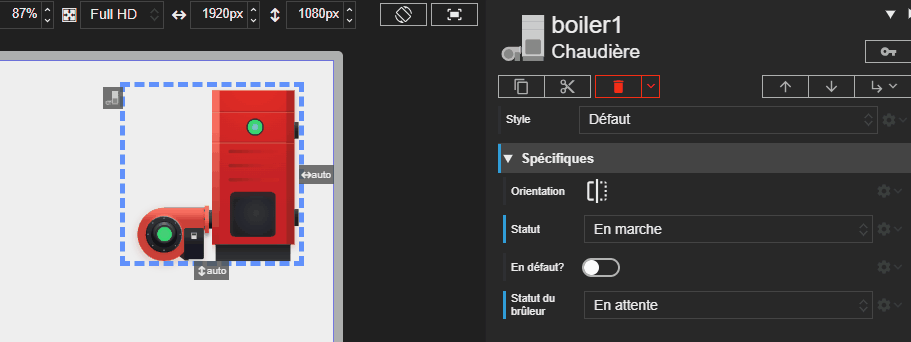

# Chaudière

L'acteur Chaudière permet de représenter l'état d'une chaudière industrielle et de son brûleur associé. Il représente visuellement les différents modes de fonctionnement comme la marche, l'arrêt ou un état de défaut.

Voici les différents états de la chaudière :

| État                   | Description                                         | État LED    | Couleur LED |
| ---------------------- | --------------------------------------------------- | ----------- | ----------- |
| **Arrêtée**            | La chaudière est éteinte et ne fonctionne pas.      | Éteinte     | ▫️          |
| **En marche**          | La chaudière est allumée et fonctionne normalement. | Allumée     | 🟩          |
| **Démarrage en cours** | La chaudière est en train de s'allumer.             | Clignotante | 🟩          |
| **Arrêt en cours**     | La chaudière est en train de s'éteindre.            | Clignotante | 🟩          |
| **En défaut**          | La chaudière rencontre un problème.                 | Clignotante | 🟥          |





# Propriétés
{: #proprietes }



# Hérite de
{: #herite-de }


