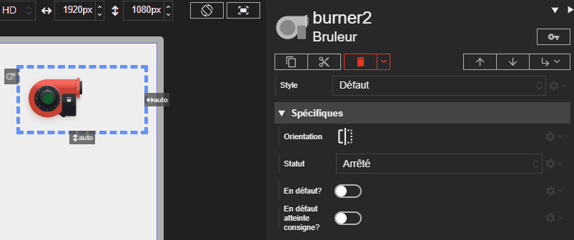

# Brûleur

L'acteur Brûleur (Burner) représente l'état d'un brûleur. Il affiche visuellement les différents modes de fonctionnement tels que la marche, l'arrêt ou un état de défaut.

Voici les différents états du brûleur :

| État                                    | Description                                                                   | État LED    | Couleur LED | Flamme     |
| --------------------------------------- | ----------------------------------------------------------------------------- | ----------- | ----------- | ---------- |
| **Arrêté**                              | Le brûleur est éteint et ne fonctionne pas.                                   | Éteinte     | -           | Éteinte    |
| **En marche**                           | Le brûleur est allumé et fonctionne normalement.                              | Allumée     | Verte       | Allumée    |
| **En attente**                          | Le brûleur est en pause, attendant une condition pour continuer.              | Clignotante | Verte       | Éteinte    |
| **Démarrage en cours**                  | Le brûleur est en train de s'allumer.                                         | Clignotante | Verte       | Allumage   |
| **Arrêt en cours**                      | Le brûleur est en train de s'éteindre.                                        | Clignotante | Verte       | Extinction |
| **Initialisation**                      | Le brûleur est en phase d'initialisation.                                     | Clignotante | Verte       | Éteinte    |
| **En défaut**                           | Le brûleur rencontre un problème.                                             | Allumée     | Rouge       | Éteinte    |
| **En défaut d'atteinte de la consigne** | Le brûleur n'a pas réussi à atteindre la température ou la condition définie. | Clignotante | Orange      | Éteinte    |





# Propriétés
{: #proprietes }



# Hérite de
{: #herite-de }


