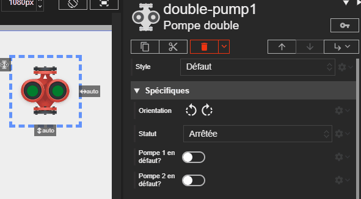

# Pompe double

L'acteur Pompe double représente un système de pompage avec deux moteurs. Chaque pompe peut être contrôlée et surveillée indépendamment pour son état de marche et de défaut.

Voici les différents états de la pompe double :

| État                  | Description                                           | État LED | Couleur LED |
| --------------------- | ----------------------------------------------------- | -------- | ----------- |
| **Arrêtée**           | Les deux pompes sont éteintes et ne fonctionnent pas. | Éteinte  | ▫️          |
| **Pompe 1 en marche** | La pompe 1 est allumée et fonctionne normalement.     | Allumée  | 🟩          |
| **Pompe 2 en marche** | La pompe 2 est allumée et fonctionne normalement.     | Allumée  | 🟩          |
| **Pompe 1 en défaut** | La pompe 1 rencontre un problème.                     | Allumée  | 🟥          |
| **Pompe 2 en défaut** | La pompe 2 rencontre un problème.                     | Allumée  | 🟥          |

{: .pin }
> L'état de défaut de chaque pompe est indépendant et a la priorité sur son état de marche.





# Propriétés
{: #proprietes }



# Hérite de
{: #herite-de }


