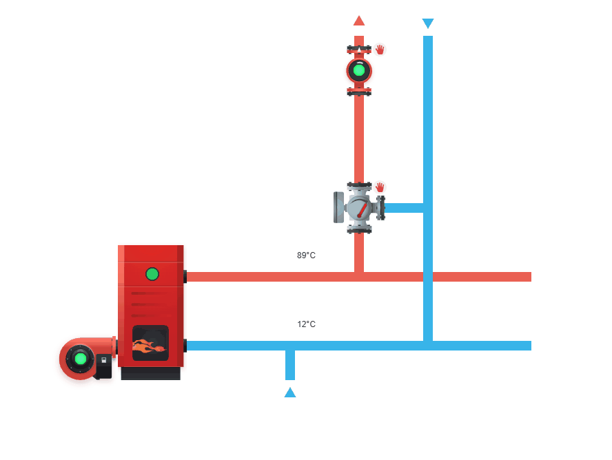



# Chaufferie & ECS

La section Chaufferie regroupe les acteurs utilisés pour représenter une installation de chauffage et ses principaux organes. Vous y trouverez les composants les plus courants d'une chaufferie, comme la chaudière, le brûleur, les circulateurs, les vannes ou encore le ballon.

## Acteurs disponibles

- [Chaudière](boiler.md)
- [Brûleur](burner.md)
- [Échangeur](exchanger.md)
- [Led](led.md)
- [Multiposition](multiposition.md)
- [Pompe simple](single-pump.md)
- [Pompe double](double-pump.md)
- [Ballon](tank.md)
- [Ternaire](ternary.md)
- [Vanne 2 voies](valve-2-ports.md)
- [Vanne 3 voies](valve-3-ports.md)
