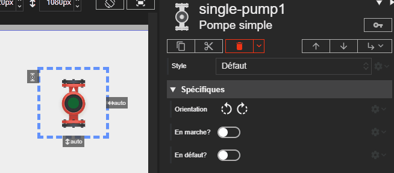

# Pompe simple

L'acteur Pompe simple représente une pompe avec un seul moteur. Son état visuel (marche, arrêt, défaut) est déterminé par ses propriétés.

Voici les différents états de la pompe simple :

| État          | Description                                     | État LED | Couleur LED |
| ------------- | ----------------------------------------------- | -------- | ----------- |
| **Arrêtée**   | La pompe est éteinte et ne fonctionne pas.      | Éteinte  | ▫️          |
| **En marche** | La pompe est allumée et fonctionne normalement. | Allumée  | 🟩          |
| **En défaut** | La pompe rencontre un problème.                 | Allumée  | 🟥          |

{: .pin }
> L'état de défaut de chaque pompe est indépendant et a la priorité sur son état de marche.





# Propriétés
{: #proprietes }



# Hérite de
{: #herite-de }


