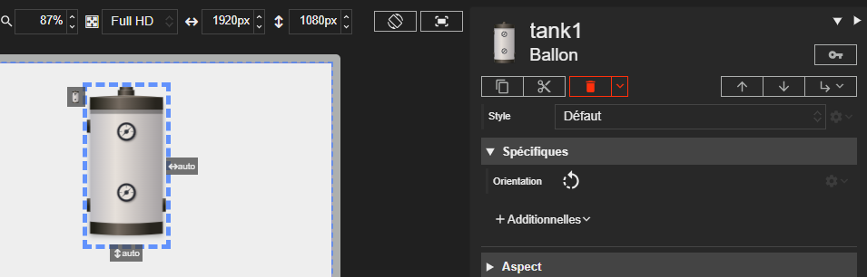

# Ballon

L'acteur Ballon est un composant visuel simple représentant un réservoir ou une cuve. Il est principalement utilisé pour la représentation graphique dans les schémas.





# Propriétés
{: #proprietes }



# Hérite de
{: #herite-de }


