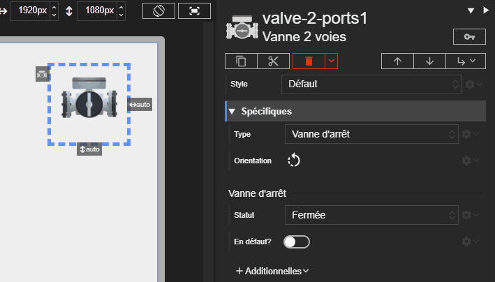

# Vanne 2 voies

L'acteur Vanne 2 voies représente une vanne standard. Son état visuel (ouverte, fermée, en mouvement, en défaut) est déterminé par ses propriétés.





# Propriétés
{: #proprietes }



# Hérite de
{: #herite-de }


