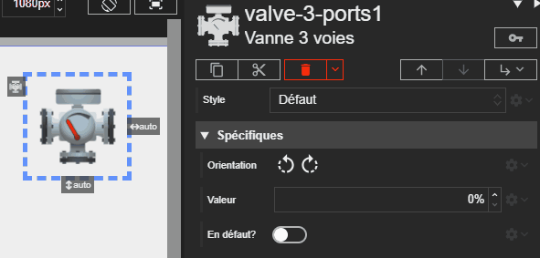

# Vanne 3 voies

L'acteur Vanne 3 voies représente une vanne de mélange ou de dérivation. Sa position est contrôlée par une valeur numérique.

La vanne 3 voies représente présente une poignée indiquant la position actuelle de la vanne, variant de **0%** à **100%**.
Si la ressource est en défaut, la poignée de la vanne est remplacée par une LED rouge clignotante.





# Propriétés
{: #proprietes }



# Hérite de
{: #herite-de }


