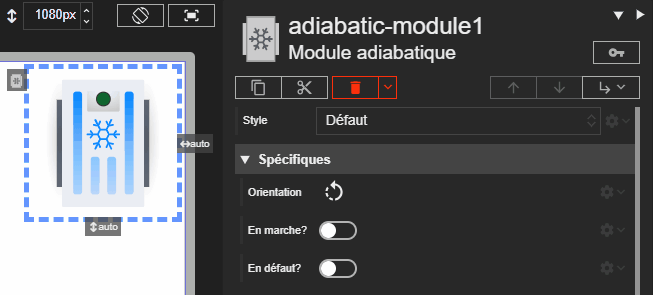

# Module adiabatique

Un module adiabatique est un organe de CTA qui rafraîchit l'air par évaporation d'eau (refroidissement adiabatique) plutôt que par un échange thermique classique avec un fluide frigorigène.

L'acteur Module adiabatique représente ce composant au sein d'une CTA. Son affichage change selon l'activation et l'état de défaut.





# Propriétés
{: #proprietes }



# Hérite de
{: #herite-de }


