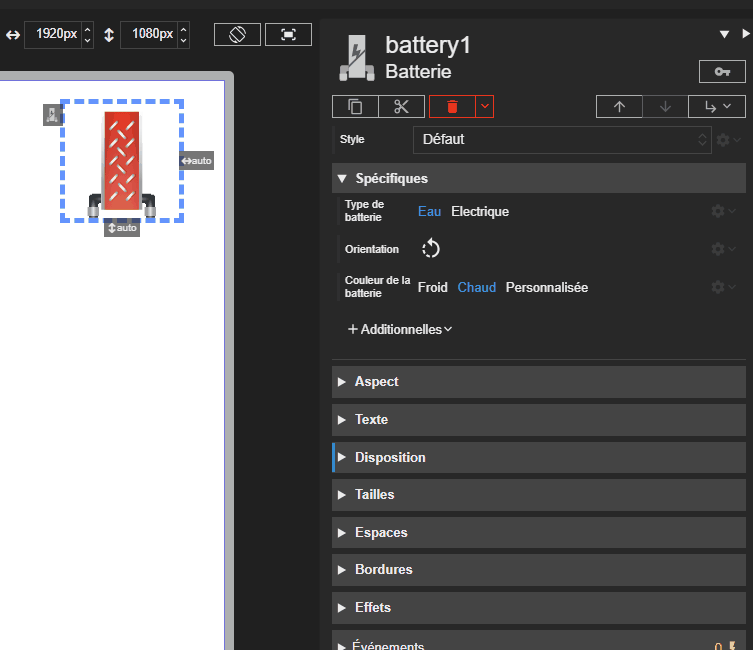

# Batterie

L'acteur Batterie représente une batterie de traitement d'air ou une batterie électrique. Il permet d'afficher un rendu coloré pour la batterie d'air et un indicateur LED pour la version électrique.
La batterie d'air possède des sortie de tuyaux à sa base afin de connecter celle-ci aux acteurs tuyaux de la chaufferie.

{: .pin }

> Pour le type `electric`, l'acteur affiche une LED d'état. Pour le type `air`, l'apparence dépend de la couleur choisie.





# Propriétés
{: #proprietes }



# Hérite de
{: #herite-de }


