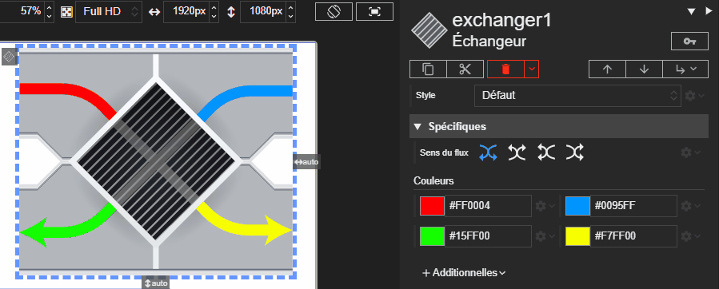

# Échangeur

L'acteur représente un échangeur. Il est possible de personnaliser le sens de circulation des flux ainsi que les couleurs des quatre flux.





# Propriétés
{: #proprietes }



# Hérite de
{: #herite-de }


