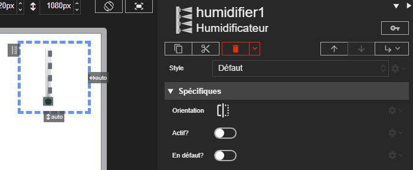

# Humidificateur

L'acteur Humidificateur représente un humidificateur de CTA. Son affichage change selon l'activation et l'état de défaut.





# Propriétés
{: #proprietes }



# Hérite de
{: #herite-de }


