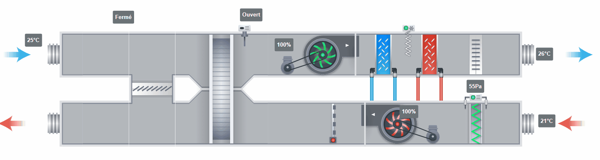



# CTA

La section CTA regroupe les acteurs utilisés pour le traitement d'air et la ventilation. On y trouve des composants de régulation, de mesure et de représentation visuelle des organes les plus courants d'une CTA.


