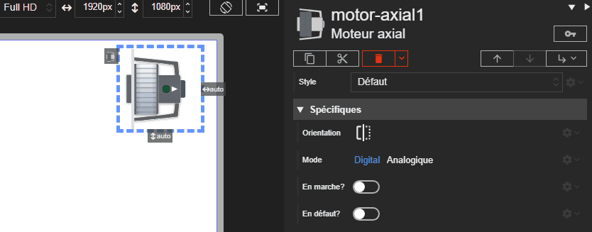

# Moteur axial

L'acteur Moteur axial représente une variante plus compacte du moteur CTA. Ses propriétés sont similaires à celles du moteur standard.





# Propriétés
{: #proprietes }



# Hérite de
{: #herite-de }


