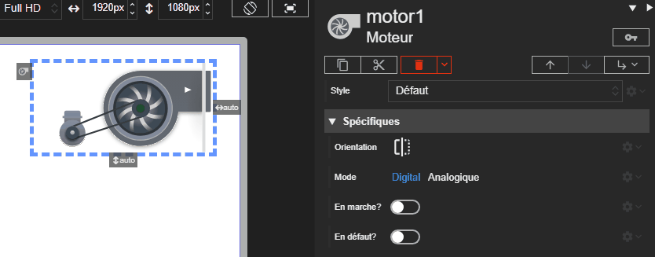

# Moteur

L'acteur Moteur représente un moteur de CTA. Il peut fonctionner en mode numérique ou analogic et affiche un indicateur LED d'état.





# Propriétés
{: #proprietes }



# Hérite de
{: #herite-de }


