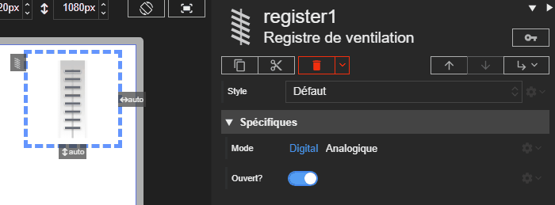

# Registre de ventilation

L'acteur Registre représente un registre de ventilation. Son fonctionnement est très proche du bypass : le mode numérique alterne entre ouvert et fermé, tandis que le mode analogic expose un pourcentage d'ouverture.





# Propriétés
{: #proprietes }



# Hérite de
{: #herite-de }


