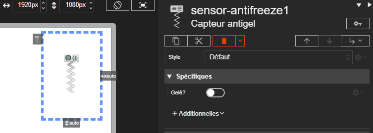

# Capteur antigel

L'acteur Capteur antigel représente un capteur de surveillance du risque de gel. Son affichage reste simple et met en avant un état de défaut visuel lorsque l'alarme est active.





# Propriétés
{: #proprietes }



# Hérite de
{: #herite-de }


