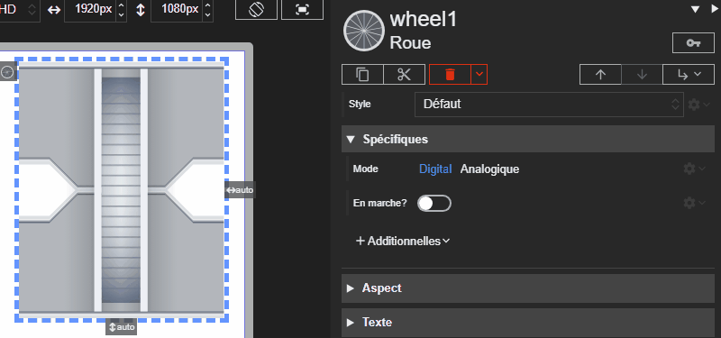

# Roue

L'acteur Roue représente un ventilateur ou une roue de CTA. Il réagit à un mode numérique ou analogic et adapte la durée d'animation à la vitesse.





# Propriétés
{: #proprietes }



# Hérite de
{: #herite-de }


