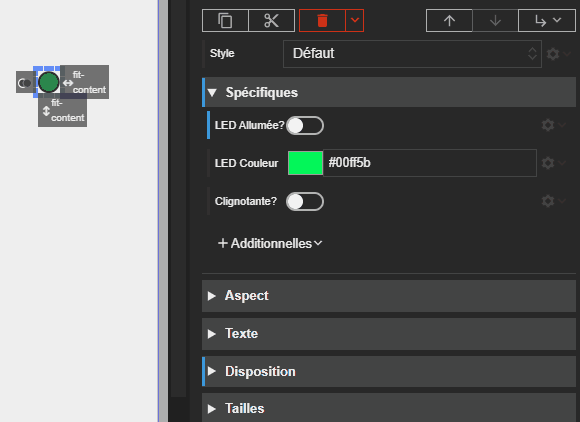

# LED

L'acteur Led permet d'afficher un indicateur lumineux simple (semblable à une LED), utile pour représenter un état (par exemple, allumé/éteint, actif/inactif, alarme).





# Propriétés
{: #proprietes }



# Hérite de
{: #herite-de }


