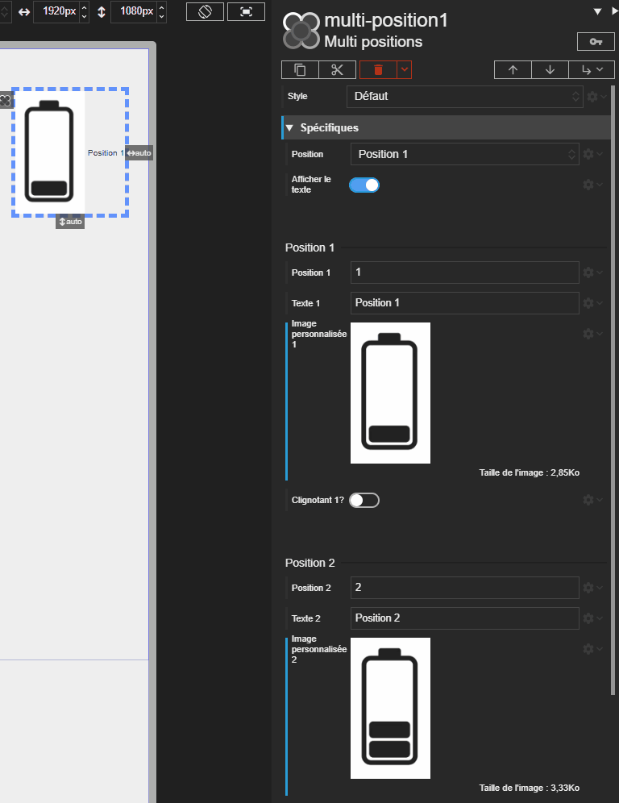

# Acteur Multiposition

L'acteur Multiposition permet d'afficher un état parmi une liste de "positions" configurables. C'est un composant idéal pour représenter un équipement ayant plusieurs modes de fonctionnement (ex: Arrêt, Manuel, Auto, Alarme).

L'acteur peut gérer jusqu'à 8 positions. Par défaut, il est créé avec 4 positions, mais vous pouvez en ajouter ou en supprimer selon vos besoins.





# Propriétés
{: #proprietes }



# Propriétés des positions

Chaque position dans la liste est un objet configurable avec les propriétés suivantes, où `<n>` est l'index de la position (1 à 8) :

- **Position** `position<n>` : Une clé unique (ex: "mode_auto") pour identifier la position. Cette clé peut être utilisée pour activer la position via la propriété Position.
- **Texte** `text<n>` : Le texte à afficher lorsque cette position est active.
- **Image personnalisée** `picture<n>` : Le chemin d'accès ou l'URL de l'image à afficher pour cette position.
- **Clignotant?** `isBlinking<n>` : Si `true`, l'image de cette position se mettra à clignoter.

# Hérite de
{: #herite-de }


