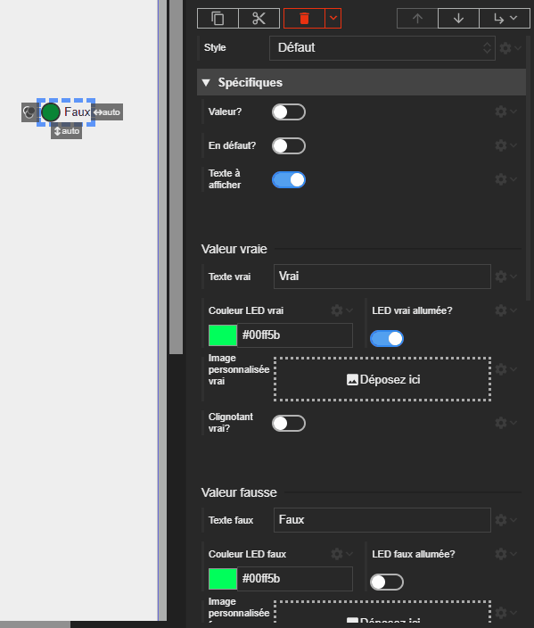

# Acteur Ternaire

L'acteur Ternaire permet d'afficher un des trois états distincts en fonction d'une valeur et d'un état de défaut :

1.  **État Vrai** : Lorsque la `value` est vraie.
2.  **État Faux** : Lorsque la `value` est fausse.
3.  **État de Défaut** : Lorsqu'un défaut est signalé via `isFault` (cet état a la priorité sur les autres).

Chaque état est entièrement personnalisable, permettant de configurer un texte, une LED ou une image et un comportement de clignotement spécifique.

La led est affichée si vous ne fournissez pas d'image personnalisée.

{: .pin }

> Par défaut, l'acteur Ternaire affiche une LED verte allumée pour l'état Vrai, une LED verte éteinte pour l'état Faux, et une LED rouge clignotante pour l'état de Défaut.





# Propriétés
{: #proprietes }

Ces propriétés contrôlent l'état global de l'acteur.



# Hérite de
{: #herite-de }


