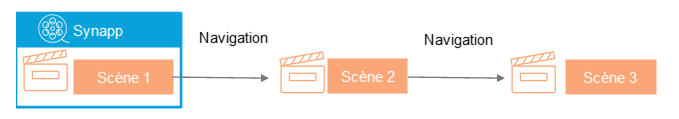

# La navigation dans une synapp

## Navigation simple

La synapp, lorsqu'elle démarre, affiche la scène de départ.

Si votre synapp contient plusieurs scènes, vous pouvez naviguer entre elles simplement en utilisant des [acteurs boutons de navigation](./actor-types/input/nav-button.md).

{: .info }
> Vous pouvez aussi naviguer par script voir [ici](./scripts/usefull-scripts.md#navigation-entre-scènes)

## Navigation dans un acteur écran

Si votre scène contient un [acteur écran](./actor-types/display/screen.md), vous pouvez le faire afficher une autre scène aussi grâce à un [acteur bouton de navigation](./actor-types/input/nav-button.md) en lui spécifiant le nom de l'acteur écran considéré.

{: .info }
Le champ [scène](./actor-types/display/screen.md#scene) de l'acteur écran peut être défini manuelle par liaison ou par script.

## Navigation paramétrée

Un bouton de navigation peut également servir à paramètrer une scène. Pour cela, le designer vous aidera : Sélectionner la scène à afficher, si elle possède des paramètres, le designer vous invitera à les ajouter pour en faire le réglage.

### Dans un acteur écran

Il est possible de paramétrer une scène visualisée dans un acteur écran. [voir ici](./actor-types/display/screen.md#scene)

## Les acteurs de navigation

- [Bouton de navigation](./actor-types/input/nav-button.md) : affiche une scène, dans la synapp ou dans un acteur écran, avec ses paramètres.
- [Bouton de menu](./actor-types/input/menu-button.md) : bouton d'un menu de navigation, qui sélectionne une scène et prend le style actif quand elle est affichée.
- [Menu de navigation](./actor-types/input/nav-menu.md) : conteneur d'un menu ; il porte la scène sélectionnée et distribue les styles actif et inactif à ses groupes et boutons.
- [Groupe de navigation](./actor-types/input/nav-group.md) : section repliable d'un menu de navigation, qui regroupe des boutons de menu.
- [Écran](./actor-types/display/screen.md) : affiche une scène à l'intérieur d'une autre.

## Naviguer par script

- Exemples : [navigation entre scènes](./scripts/usefull-scripts.md#navigation-entre-scènes) dans les scripts utiles.
- Synapp : [`context.synapp.navigate()`](./scripts/reference/synapp.md#navigatescenekey-sceneparams), qui change la scène affichée par la synapp.
- Scène : [`context.scene.navigate()`](./scripts/reference/scene.md#navigatescenekey-additionals), qui navigue depuis la scène qui contient l'acteur (dans un acteur écran, c'est l'écran qui change de scène).
- Écran : `navigate()` sur un [acteur écran](./actor-types/display/screen.md).
- Bouton de navigation : `navigate()` déclenche la navigation configurée sur le [bouton](./actor-types/input/nav-button.md).
