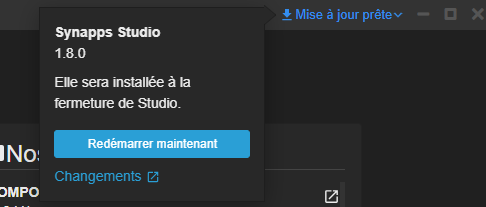
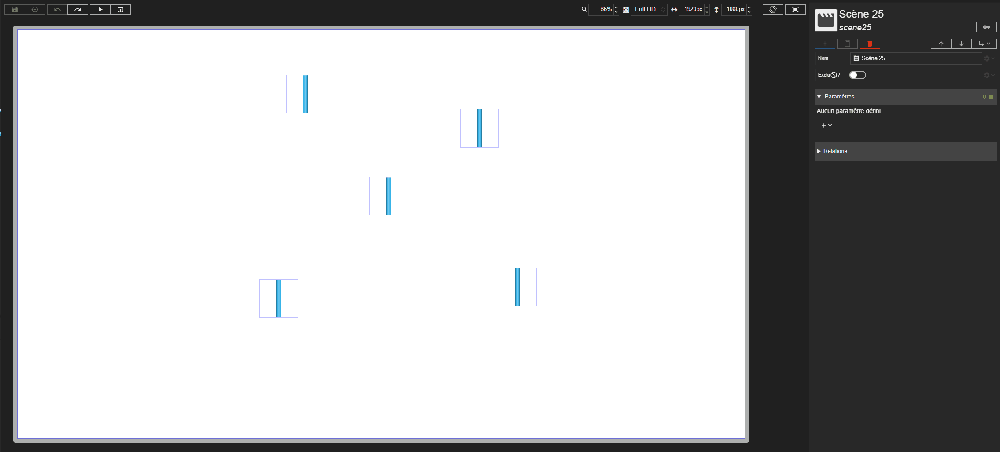

# Notes de version `1.8` beta

Nouvelle version mineure de Studio, en beta. Les évolutions sont décrites par rapport à la dernière
version officielle, `1.7.2` : voir ses [notes de version](./1.7.md).

## Révisions

> 1.8.0-beta - 2026-10-13T00:00:00

- Nouvel installeur et mises à jour de Studio téléchargées en arrière-plan.
- Installation de Studio pour l'utilisateur, sans droits d'administrateur.
- Multisélection des acteurs dans une toile pour les manipuler simultanément (déplacement, disposition).
- Menu contextuel dans la prévisualisation d'une scène : actions sur l'acteur et sélection d'un acteur sous le curseur.
- Plier / déplier tous les dossiers de scènes et les acteurs.
- Un nouveau dossier se nomme dès sa création.
- Ajout d'un additionnel de type _Style_.
- Menus d'ajout d'additionnel et d'événement regroupés par type.
- Corrections diverses (voir ci-dessous).



## Synapps Runtime version 2.9.3

- Support de la version `2.9.3` de Synapps Runtime, disponible dans la version de REDY `17.0.0`.
- Ajout de l'acteur technique _Module Adiabatique_.
- Ajout des acteurs de _Barre de Navigation_.
- Correction de l'acteur _Tuyaux_ et sa représentation _Flèche_ qui n'avait pas de taille.
- Ajout de la propriété _Entête?_ sur l'acteur _Groupe de navigation_ pour permettre de définir si le groupe est un entête ou non.
- Correction de la tooltip de l'acteur _Ternaire_ qui n'était pas prise en compte.

## Nouveautés

### Installation et mises à jour

Studio dispose d'un nouvel installeur.

- Studio s'installe pour l'utilisateur, sans droits d'administrateur. Une installation précédente de Studio est reprise automatiquement.
- Les futures mises à jour sont téléchargées en arrière-plan. Quand une mise à jour est prête, elle est signalée dans la barre de titre : un clic lance son installation, qui affiche sa progression puis relance Studio.
- Seules les parties modifiées de Studio sont téléchargées lors d'une mise à jour, ce qui accélère son téléchargement.

### Multisélection des acteurs

Il est maintenant possible de sélectionner plusieurs acteurs dans une toile pour les manipuler simultanément (déplacement, disposition). Les acteurs sélectionnés sont également indiqués dans la liste des acteurs de la scène.

Les contrôles et les actions disponibles sont détaillés dans la [documentation de la multisélection](../../concepts/multi-selection.md).

### Menu contextuel dans la prévisualisation

Un clic droit dans la prévisualisation d'une scène ouvre un menu contextuel sur l'acteur situé sous le curseur, avec les mêmes actions que dans la liste des acteurs de la scène (copier, couper, coller, dupliquer, supprimer…).

Son sous-menu _Sélectionner_ liste tous les acteurs situés sous le curseur. Il permet de sélectionner facilement un acteur recouvert par un autre.

Le fonctionnement est détaillé dans la [documentation de la sélection contextuelle](../../concepts/context-selection.md).

### Plier / déplier

- Ajout de la possibilité de plier / déplier tous les dossiers de scènes dans l'explorateur de scènes.
- Le menu contextuel d'un dossier de scènes et celui d'un acteur conteneur proposent _Tout plier_ / _Tout déplier_.
- Les sous-dossiers de scènes sont pliés au démarrage.

### Dossiers

Un nouveau dossier est nommé dès sa création, dans la même boîte de dialogue que pour le renommer. La touche `Entrée` valide la saisie.

### Additionnel de type _Style_

Ajout d'un additionnel de type _Style_. Il est également pris en charge dans l'inspecteur des composites.

### Menus d'ajout

- Le menu d'ajout d'additionnel regroupe les types par catégorie (valeurs, objets Synapps, REDY, Highway).
- Le menu d'ajout d'événement suit la même présentation.

### Explorateurs

- L'affichage de l'explorateur de variables a été optimisé pour des paramétrages avec de nombreuses ressources.

### Squelette de la modale

Les squelettes de la modale et de ce qu'elle contient ne gènent plus lorsque la modale n'est pas affichée. Il n'est plus nécessaire de placer arbitrairement les modales le plus bas possible dans l'arborescence des acteurs.

## Corrections

### Explorateur de variables

- En mode ressource seulement ou reflet, la liste s'affiche correctement lorsque `:easy.RESS` a été choisi comme valeur.

### Déplacement d'acteurs

- Correction d'un décalage lors du déplacement d'un acteur ayant une rotation ou une mise à l'échelle.
- Le squelette reste aligné sur l'acteur pendant et après son déplacement.
- La liste des acteurs défile de nouveau jusqu'à l'acteur sélectionné.

### Ajout d'un acteur principal

- L'annulation et le rétablissement de l'ajout d'un acteur principal aux propriétés préremplies (par exemple la modale au clic) fonctionnent correctement.

### Copier / coller d'acteurs

- Lors d'un copier / coller, certaines clés d'acteurs (par exemple `pole1variable`) n'étaient pas correctement renommées.

### Scènes et composites

- Correction de la modification par glissement des attributs de couleur, de nombre et de taille sur les scènes et les composites.

### Affichage

- Les menus ne passent plus sous la barre d'onglets du designer de scènes et de composites.
- Le contenu des fenêtres des explorateurs et des autres grands popovers défile au lieu de sortir de la fenêtre.
