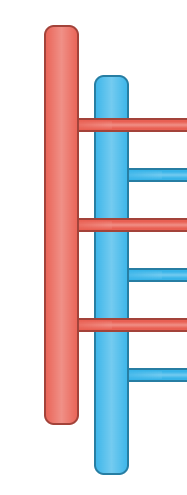
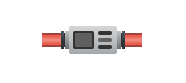
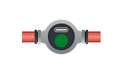
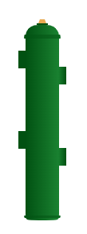
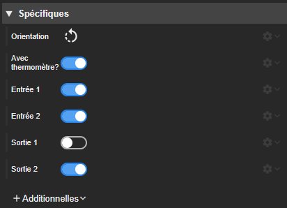

<!--
  BROUILLON : complété à chaque fusion de PR, finalisé à la publication
  (version, révision, captures, version du Runtime et de REDY 18).
  À ajouter au fil des fusions : Journal des reflets (filtre de site).
  Captures à faire : Grille (inspecteur, popover des pistes, aperçu des cellules).
-->

# Notes de version `1.9` beta

Cette version beta s'appuie sur la version officielle `1.8` : voir ses [notes de version](./1.8.md).
Seules les évolutions de la beta sont décrites ici.

## Révisions

> 1.9.0-beta - _à venir_

- Champ _Taille_ : toutes les fonctions CSS sont acceptées.
- _Ballon_ : thermomètre, entrées et sorties affichables séparément.
- _Journal_ : colonne _Acquitté par_.
- _Graphique_ : filtre de la liste des préparations.
- Nouvel acteur de disposition _Grille_.
- Nouveaux acteurs ECS : _Collecteur_, _Compteur d'énergie_, _Compteur volumétrique_ et _Bouteille casse-pression_.
- _Tuyau droit_ : la taille ne peut plus être négative.
- Connexions aux REDY : une seule session pour toutes les prévisualisations, sessions fermées à la fermeture de Studio.
- Additionnelles : libellés des types de modification plus explicites.



## Synapps Runtime

- Support de la version de Synapps Runtime livrée avec REDY `18`.
- La session REDY n'est plus conservée après la fermeture du navigateur : elle est propre à chaque onglet. Recharger la page la garde ; un nouvel onglet ou un redémarrage du navigateur demande une nouvelle connexion. Le bouton d'ouverture dans un autre onglet transmet la session.

## Nouveautés

### Champ Taille

- En saisie numérique, le champ accepte toute fonction CSS : `calc()`, `min()`, `max()`, `clamp()`, `var()`… La valeur est conservée telle quelle, comme en saisie texte.
- Une fonction peut aussi être collée dans le champ.

### Grille

Nouvel acteur de disposition qui range ses enfants en lignes et en colonnes.

- _Colonnes_ et _Lignes_ : une taille par piste (`1fr` = une part de la place libre, `auto` = selon le contenu, px, `minmax()`, `repeat()`…), éditables dans un popover (ajout, suppression, réordonnancement).
- _Espacement_, _Remplissage_ (par ligne ou par colonne) et _Taille automatique_ des pistes ajoutées.
- _Alignement des pistes_ dans la grille et _Alignement dans les cellules_ pour tous les enfants.
- Chaque enfant se place par sa _Colonne_ et son _Nombre de colonnes_ (idem pour les lignes) ; `0` = jusqu'à la dernière colonne, pour un bandeau sur toute la largeur.
- Les cellules s'affichent dans le designer dès que la grille ou un de ses enfants est sélectionné.

### Acteurs ECS

Quatre nouveaux acteurs dans la section _Chaufferie & ECS_ de la palette :

- _Collecteur_ : laiton, rouge, bleu ou couleur personnalisée, avec son orientation et sa longueur (à partir de 1).
- _Compteur d'énergie_ et _Compteur volumétrique_ : avec la communication activée, un voyant indique la marche et le défaut.
- _Bouteille casse-pression_ : 2, 4 ou 6 sorties ; sa teinte suit la couleur du texte, comme la _Chaudière_.

### Ballon

Le _Ballon_ a de nouvelles propriétés pour choisir ce qu'il affiche : _Avec thermomètre?_, _Entrée 1_, _Entrée 2_, _Sortie 1_ et _Sortie 2_.

- Par défaut, le ballon garde son aspect actuel : thermomètre, entrées 1 et 2 et sortie 2 affichés, sortie 1 masquée.
- Ces propriétés peuvent être liées ou modifiées par script.

### Graphique

- _Filtre des préparations_ : un texte qui filtre la liste des préparations du grapheur (titre ou propriétaire, sans tenir compte de la casse).
- _Montrer le filtre des préparations?_ : masque le champ de filtre de la liste ; le filtre choisi s'applique toujours. Une liste pré-filtrée et verrouillée devient possible.
- Correction : la _Version_ choisie du grapheur est maintenant utilisée (elle était remplacée par `Latest`).

### Journal

- Nouvelle colonne _Acquitté par_ : l'utilisateur qui a acquitté l'évènement. Elle s'ajoute dans la propriété _Colonnes_ ; elle n'est pas affichée par défaut.

### Tuyau

- La taille du _Tuyau droit_ ne peut plus être négative (0 reste possible).

### Connexions aux REDY

- Les prévisualisations du designer, l'exécution et l'exécution dans le navigateur partagent une même session sur le REDY, au lieu d'en ouvrir une par onglet ou à chaque ouverture de projet.
- Les sessions ouvertes par Studio sont fermées sur le REDY à la fermeture de Studio.
- _Récupérer un projet_ : la déconnexion ferme la session sur le REDY ; un identifiant ou un mot de passe erroné est signalé comme tel.
- Chaque connexion n'ouvre plus qu'une session sur le REDY, au lieu de deux.

### Types de modification

Les libellés des types de modification d'une additionnelle disent maintenant ce qu'ils recalculent, et l'aide du champ est plus précise. Voir [Évènement de modification]({{ site.baseurl }}/concepts/actor/#évènement-de-modification).

| Avant | Maintenant | Ce qui est recalculé |
|---|---|---|
| Aucun | _Aucun_ | rien |
| Style CSS | _Style seulement_ | le style |
| Rendu | _Gabarit de l'acteur_ | le rendu, puis les tailles de l'acteur |
| Gabarit | _Gabarit parent + enfants_ | le rendu, puis les tailles de l'acteur, de son parent et de ses enfants directs |

Seuls les libellés changent, ici et dans la référence de l'API des scripts : les synapps existantes et les REDY déjà installés ne sont pas concernés, et le champ `modifier` du contexte des évènements garde ses valeurs (`other`, `css`, `resize`, `render`, `layout`).
